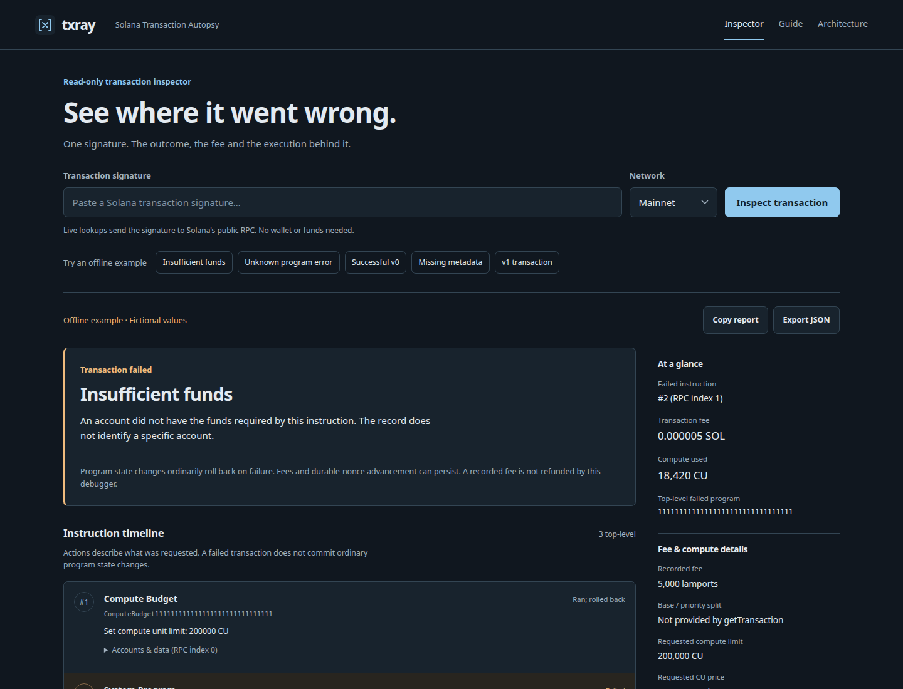

# txray

**Solana Transaction Autopsy.** Paste a transaction signature and understand the failure, fee and execution behind it.



## Run locally

Requires **Node.js 22.18+** and npm.

```sh
npm install
npm run demo
```

Open **http://127.0.0.1:4450**. Paste a signature, select Mainnet or Devnet, and inspect it. Or choose a labeled offline example. No wallet, SOL, API key or account needed.

## What you get

- Plain explanations for known runtime errors. Unknown custom errors stay unknown.
- Failed top-level instruction, program addresses and nested execution logs.
- Exact recorded fees, compute consumption and requested compute settings.
- Legacy, v0 and v1 support, with visible missing-data notes.
- Copyable diagnostics and JSON export with the full returned record.

Runs on your computer. No database, saved lookup history, telemetry or hosted service. Live signatures go to Solana's public RPC; availability, rate limits and historical coverage vary.

The RPC provides a total fee, not an exact base/priority split. Decoding covers basic System transfer and Compute Budget instructions; other instruction data stays available without guessed meanings. This is an execution debugger, not a security verdict or a full balance-change explorer.

**[Guide](docs/guide.md)** · **[Architecture](docs/architecture.md)** · **[Local API](docs/api.md)**

Guide and architecture pages are also available inside the dashboard, offline.

## Develop

```sh
npm run check
npx playwright install chromium
npm run test:e2e
```

Tests do not depend on public RPC. To use another local port: `PORT=4452 npm run demo`.

[Contributing](CONTRIBUTING.md) · [Changelog](CHANGELOG.md) · [MIT](LICENSE)
