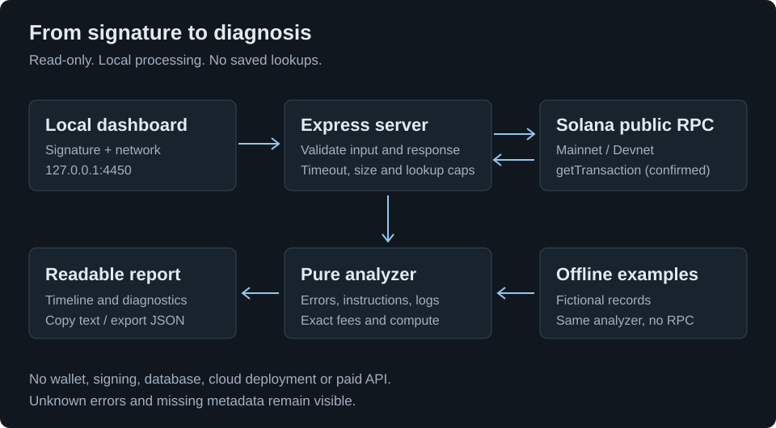

# Architecture

The browser asks a local Express server for a transaction. The server queries a fixed public Solana RPC endpoint, validates the response, and runs a pure analyzer. No database, wallet, hosted backend or paid API is required.

| Part                       | Responsibility                                                                          |
| -------------------------- | --------------------------------------------------------------------------------------- |
| `src/web/app.ts`           | Signature form, diagnostics, timeline, text copy and JSON download                      |
| `src/app.ts`               | Local HTTP boundary, input checks, security headers and lookup limits                   |
| `src/adapters/rpc.ts`      | Confirmed JSON RPC reads, exact integers, timeout and response cap                      |
| `src/domain/`              | Response schema, account resolution, known errors, instruction decoding and log parsing |
| `src/adapters/examples.ts` | Clearly labeled fictional records, analyzed by the same domain code                     |

## Trust boundaries

Only the fixed Mainnet and Devnet endpoints can be queried. User-supplied RPC URLs are not accepted. The server binds to `127.0.0.1` and checks Host, Origin and cross-site fetch headers. The browser uses a same-origin content security policy. Log text is inserted as text, never HTML.

The RPC response is the source of observations. Known runtime errors are mapped conservatively; custom errors have no guessed meanings. Fee amounts and large integers remain exact decimal strings. Per-program logs do not override `meta.err` or establish a root cause by themselves.

Live results stay in process memory for the request and in the current browser view. They are not written to disk. Examples contain no real transaction claims. The only file output is a user-requested browser export.

## Running and testing

`npm run demo` builds the TypeScript server, bundles the small browser entry and generates the guide and architecture pages. Both pages are available inside the dashboard without a Markdown viewer or internet.

Unit tests cover domain behavior. API tests replace the external fetch boundary, while running real handlers. Browser tests use a local test server and exercise the full form, rendering and export path without a public RPC dependency.

[Guide](guide.md)
